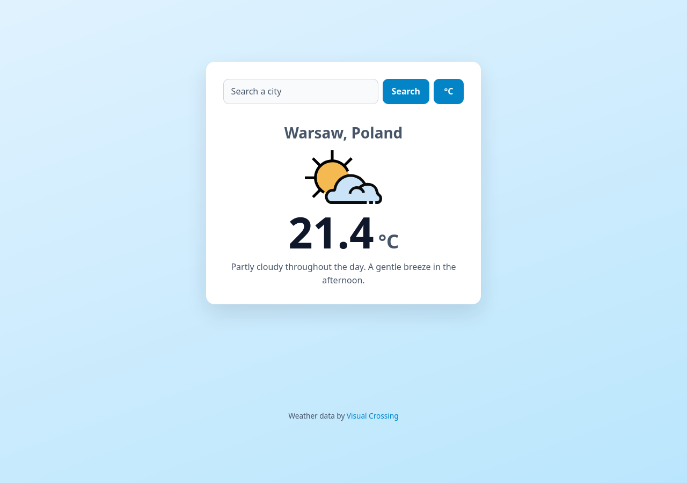

# Weather App

Live preview : [here](https://filipnowakway.github.io/Weather-App/)

A small vanilla JavaScript weather app. It uses your location to show the
current forecast, lets you search for any city, and switches between °C and °F.
Weather data comes from the [Visual Crossing](https://www.visualcrossing.com/)
API.



## Features

- Geolocation-based forecast on load
- City search
- Celsius / Fahrenheit toggle
- Weather icons loaded from SVG assets
- Responsive card layout with a data-source attribution footer

## Quick start

```bash
npm install
npm run dev
```

The dev server runs at <http://localhost:8080>.

The weather request in `src/modules/fetchWeather.js` uses a Visual Crossing API
key. Replace it with your own key if you plan to deploy the app.

## Scripts

| Command                | Description                                       |
| ---------------------- | ------------------------------------------------- |
| `npm run dev`          | Start the dev server with inline source maps      |
| `npm run build`        | Build minified files into `dist/`                 |
| `npm run deploy`       | Format, build and publish `dist/` to GitHub Pages |
| `npm run lint`         | Check files with ESLint                           |
| `npm run lint:fix`     | Fix auto-fixable ESLint errors                    |
| `npm run format`       | Format files with Prettier                        |
| `npm run format:check` | Check formatting without changing files           |

`npm run deploy` runs format first, so the published `dist/` is always built
from formatted source. Lint is not part of the deploy pipeline — run it
separately if needed.

## Project structure

```text
src/
├── assets/icons/  SVG weather icons
├── modules/       geolocation, API, display and temperature toggle logic
├── styles/        reset.css, main.css (layout) and weather.css (forecast)
├── index.js       application entry point
└── template.html  HTML template used by HtmlWebpackPlugin
docs/
└── screenshot.png preview used in this README
```

Styles and assets imported from JavaScript are bundled automatically:

```js
import "./styles/main.css";
```

## Linting and formatting

ESLint checks JavaScript, JSON, Markdown, CSS, and shell files using the flat
config in `eslint.config.js`. Generated files (`dist/`, `package-lock.json`)
are skipped.

Prettier formats the project. Paths listed in `.prettierignore`
(`node_modules/`, `dist/`, `package-lock.json`) are left untouched.

Run both checks before committing:

```bash
npm run lint
npm run format:check
```

Use `npm run lint:fix` and `npm run format` to apply fixes automatically.

## Requirements

Node.js 22.15 or newer.

## License

MIT — see [LICENSE](./LICENSE).
